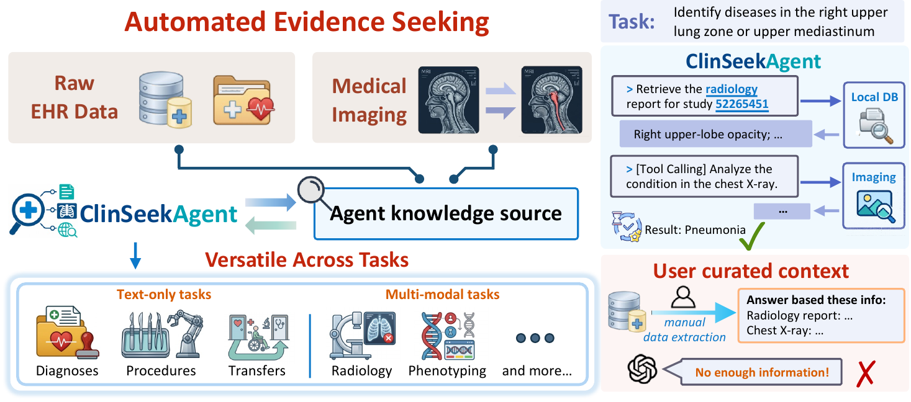
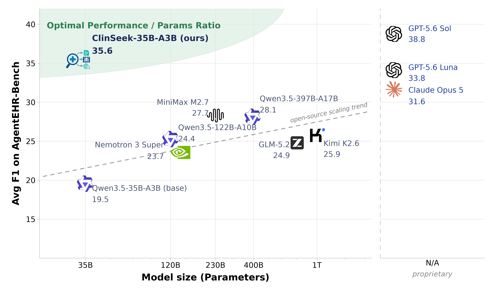

<div align="center">

# 🔎 ClinSeekAgent

**Automating multimodal evidence seeking for agentic clinical reasoning**

[](#install)
[](#repository-layout)
[](#data-artifacts)
[](LICENSE)
<br>
[](https://arxiv.org/abs/2605.20176)
[](https://huggingface.co/collections/UCSC-VLAA/clinseekagent)

🌐 Project page: https://ucsc-vlaa.github.io/ClinSeekAgent/

[Quick Start](#quick-start) • [Data](#data-artifacts) • [Docs](#documentation) • [Training](#sft-training) • [Responsible Use](#responsible-use)

</div>

ClinSeekAgent is an automated agentic framework for multimodal evidence seeking in clinical reasoning. Given a task, a patient identifier, and a prediction time, the agent queries the patient's raw longitudinal EHR and calls chest X-ray analysis tools, refines its hypotheses as evidence arrives, and returns a grounded decision. Every tool only sees the record that was available before the prediction time (strict temporal policy).

> **[ClinSeekAgent: Automating Multimodal Evidence Seeking for Agentic Clinical Reasoning](https://arxiv.org/abs/2605.20176)**

The 22-tool space has 16 EHR tools (schema exploration, time-, keyword- and value-based retrieval, SQL, candidate lookup, `think`, `finish`) and 6 image tools. ClinSeekAgent is validated in two roles: as an **inference-time agent** for frontier LLMs, and as a **training pipeline** that distills trajectories into an open model.

> [!IMPORTANT]
> This repository does **not** include raw MIMIC data, generated patient databases, chest X-ray files, serialized patient records, or SFT training trajectories. Benchmark metadata, model weights, and gated evaluation outputs are on Hugging Face; see [Data artifacts](#data-artifacts).

<p align="center">
  
</p>

## 📊 Headline Results

**ClinSeek-Bench** has two parts: ClinSeek-Bench-Text (1,800 EHR questions, 13 task categories) and ClinSeek-Bench-MM (989 EHR + chest X-ray questions, 6 task categories). Each question is paired with a **Curated Input** (evidence pre-selected from the record available at the prediction time) and with the raw record for ClinSeekAgent. Overall F1 (%):

| Model | Benchmark | Curated Input | ClinSeekAgent | Δ |
| --- | --- | ---: | ---: | ---: |
| Claude Opus 5 | ClinSeek-Bench-Text | 61.7 | **63.9** | **+2.2** |
| GPT-5.6 Sol | ClinSeek-Bench-Text | 57.8 | **59.3** | **+1.6** |
| Claude Opus 5 | ClinSeek-Bench-MM | 66.5 | **68.8** | **+2.3** |
| GPT-5.6 Sol | ClinSeek-Bench-MM | 60.0 | **62.5** | **+2.5** |

Bold Δ: the paired-bootstrap 95% CI excludes zero. The largest gains are on text decision making and multimodal phenotype prediction; ablations show they come from multi-round evidence seeking rather than from access to more of the patient record.

**Distilled student (AgentEHR-Bench, average F1, 100 questions per task):**

| Model | Average F1 |
| --- | ---: |
| Qwen3.5-35B-A3B (base) | 19.5 |
| **ClinSeek-35B-A3B (ours)** | **35.6 (+16.1)** |
| Claude Opus 5 | 31.6 |
| Claude Opus 4.6 | 33.2 |
| GPT-5.6 Sol (teacher) | 38.8 |

ClinSeek-35B-A3B is fine-tuned on trajectories generated by GPT-5.6 Sol. It outperforms all evaluated open-source models, including Qwen3.5-397B-A17B (28.1), and reaches 92% of its teacher.

<p align="center">
  
</p>

> **A note on settings.** ClinSeek-Bench-Text keeps the questions, labels, and task definitions of EHR-Bench ([EHR-R1](https://arxiv.org/abs/2510.25628)), but changes how evidence reaches the model: the original benchmark provides up to 100 events from the 24 hours before the prediction time, whereas ClinSeekAgent retrieves evidence from the patient's full record before that time through tools. For [AgentEHR-Bench](https://arxiv.org/abs/2601.13918), which also lets agents query patient databases, we use the benchmark's questions with our own 16-tool interface and a stricter runtime view (for example, we do not treat its synthetic diagnosis timestamps as evidence of availability and drop the discharge-summary text copied into the admissions table). We evaluate 100 questions for each of five tasks. Scores may therefore differ from numbers reported under the original settings and are best compared within this repository.

<a id="repository-layout"></a>
## 🧩 Repository Layout

| Path | Purpose |
| --- | --- |
| `clinseekagent/` | Runners for the four inference modes (ClinSeekAgent, Single-Pass Retrieval, Curated Input, Full-Record Input), LLM backends (AWS Bedrock, Google Vertex AI, OpenAI-compatible / vLLM), tool-pool clients, record renderers, and scorers |
| `src/run_mcp_server.py`, `src/agentlite/` | EHR MCP server, EHR tools, and the strict temporal policy |
| `src/mcp_image/` | Medical-image MCP server and image tools |
| `scripts/` | Launchers (MCP servers, evaluation, four modes, AgentEHR-Bench, vLLM, SFT), result checks, forced final-answer round |
| `scripts/data_build/` | Benchmark reconstruction, schema restoration, strict-manifest rendering, and validators |
| `scripts/clean_data/` | Curated Input / Full-Record corpus builder |
| `verl/` | Vendored VERL training code and the ClinSeek-35B-A3B SFT recipe |
| `tests/` | Unit tests (`python -m pytest tests`) |
| `docs/` | Data, evaluation, and training guides |
| `venvs/requirements/` | Per-role dependency files (agent driver, EHR MCP, image MCP, SFT training) |
| `assets/` | Figures used in this README |
| `examples/` | Synthetic manifest examples only |

<a id="install"></a>
## ⚙️ Install

ClinSeekAgent is split into **four roles** with separate dependency files so you only install what you need. The agent driver and the MCP servers should each live in their own environment: the agent driver is a thin HTTP/SDK client, while the MCP servers and SFT training pull in heavy GPU and ML stacks. All four files are resolved against **Python 3.12**.

```bash
cp .env.example .env   # fill values for the roles you plan to run
```

### 1. Agent driver — `venvs/requirements/bedrock_agent.txt`

Runs inference and scoring. No GPU.

```bash
python -m venv .venvs/agent && source .venvs/agent/bin/activate
pip install -r venvs/requirements/bedrock_agent.txt
python -m pytest tests          # optional: unit tests
```

Select the model provider with `--backend {bedrock,vertex,vllm}` (or `BACKEND=` for the `scripts/run_*` wrappers):

| Backend | Models | Credentials |
| --- | --- | --- |
| `bedrock` | Claude on AWS Bedrock (e.g. `us.anthropic.claude-opus-4-6-v1`) | default AWS credential chain, or `BEDROCK_API_KEY` |
| `vertex` | Claude on Google Vertex AI (bare model ids, e.g. `claude-opus-4-6`, `claude-opus-5`) | `gcloud auth application-default login` (or `GOOGLE_APPLICATION_CREDENTIALS`) plus `ANTHROPIC_VERTEX_PROJECT_ID` and `VERTEX_REGION`; check access with `python scripts/check_vertex.py <model>` |
| `vllm` | any OpenAI-compatible endpoint: a local vLLM server for ClinSeek-35B-A3B / Qwen3.5 (`scripts/run_vllm_server.sh`), or a hosted API (OpenAI reasoning models get `reasoning_effort` and `max_completion_tokens`) | `VLLM_BASE_URL`, `VLLM_API_KEY` |

### 2. EHR MCP server — `venvs/requirements/mcp_ehr.txt`

Serves `ehr.*` tool calls over MCP and enforces the temporal policy. GPU optional (used only for BioLORD semantic search).

```bash
python -m venv .venvs/mcp-ehr && source .venvs/mcp-ehr/bin/activate
# Install a torch build matching your CUDA first (the validated environment runs 2.8.0+cu126).
pip install torch==2.8.0 --index-url https://download.pytorch.org/whl/cu126
pip install -r venvs/requirements/mcp_ehr.txt
```

### 3. Image MCP server — `venvs/requirements/mcp_image.txt`

Serves the 6 `image.*` CXR tools (DICOM processor, visualizer, classifier, report generator, phrase grounding, segmentation). **GPU required.**

```bash
python -m venv .venvs/mcp-image && source .venvs/mcp-image/bin/activate
pip install --pre torch==2.9.0+cu128 torchvision==0.24.0+cu128 \
    --index-url https://download.pytorch.org/whl/cu128
pip install -r venvs/requirements/mcp_image.txt
```

> **Important:** the image MCP pins `transformers==4.46.3` to keep MAIRA-2 working. Do not co-install this environment with the agent driver.

The image server needs the Hugging Face cache that holds its models, including the gated `microsoft/maira-2` used by `xray_phrase_grounding` (export `HF_HOME`), and about 26 GB of GPU memory for MAIRA-2 alone. Pin the models with `IMAGE_TOOL_DEVICE` (all tools) or `IMAGE_TOOL_DEVICE_<CLASSIFIER|GROUNDING|REPORT_GENERATOR|SEGMENTATION>`.

#### Launching the MCP servers

Text tasks need one EHR server; multimodal tasks need **one EHR server per source benchmark** (EHRXQA and MedMod use different schemas and share subject ids) plus the image server:

```bash
EHR_DATA_PATH=$CLINSEEK_DATA_ROOT/ehr_bench EHR_MCP_PORT=5003 bash scripts/run_ehr_mcp.sh &   # text
EHR_DATA_PATH=$MM_BENCH_ROOT/ehrxqa         EHR_MCP_PORT=5004 bash scripts/run_ehr_mcp.sh &   # EHRXQA
EHR_DATA_PATH=$MM_BENCH_ROOT/medmod         EHR_MCP_PORT=5005 bash scripts/run_ehr_mcp.sh &   # MedMod
BENCH_ROOT=$MM_BENCH_ROOT IMAGE_MCP_PORT=5203 bash scripts/run_image_mcp.sh &                  # image tools
```

Each EHR server registers 18 MCP tools, of which the agent is given 16 (`clear_session_ehr` and `read_resource_data` are internal helpers); the image server exposes 6. The paper's tool space is therefore 16 tools for ClinSeek-Bench-Text and 22 for ClinSeek-Bench-MM. Web-search browser tools exist as an optional, non-default extra (`--enable_browser`).

> **A listening port is not a healthy server.** A stale MCP server answers every tool call with an error string, so the run completes with uniformly empty evidence and reads as a model result. Confirm each server completes the MCP handshake before a run, and gate results with `scripts/check_results_complete.py` before scoring.

### 4. SFT training — `venvs/requirements/sft_training.txt`

Distills ClinSeekAgent trajectories into a smaller student (paper recipe: Qwen3.5-35B-A3B on 2x H200). Install only on the training node.

```bash
python -m venv .venvs/sft && source .venvs/sft/bin/activate
pip install -r venvs/requirements/sft_training.txt
```

See [`docs/sft_training.md`](docs/sft_training.md) for the full paper recipe.

<a id="data-artifacts"></a>
## 📦 Data & Artifacts

Data is not stored in Git. The [ClinSeekAgent Hugging Face collection](https://huggingface.co/collections/UCSC-VLAA/clinseekagent) contains the released model, benchmark manifests, and evaluation results:

- 🧪 ClinSeek-Bench manifests: [`UCSC-VLAA/ClinSeek-Bench`](https://huggingface.co/datasets/UCSC-VLAA/ClinSeek-Bench) — `ClinSeek-Bench_text.json` (1,800 questions, 13 categories) and `ClinSeek-Bench_multimodal.jsonl` (989 questions, 6 categories)
- 🤖 ClinSeek-35B-A3B model checkpoint: [`UCSC-VLAA/ClinSeek-35B-A3B`](https://huggingface.co/UCSC-VLAA/ClinSeek-35B-A3B)
- 📊 Evaluation results: [`UCSC-VLAA/ClinSeek-Evaluation-Results`](https://huggingface.co/datasets/UCSC-VLAA/ClinSeek-Evaluation-Results)

The manifests carry identifiers, questions, labels, and the trusted temporal / scope metadata, but no MIMIC-derived records: patient databases, CXR images, and rendered EHR context are rebuilt locally from credentialed PhysioNet downloads (see the data preparation guides). See [`RESOURCES.md`](RESOURCES.md) for the full inventory.

```bash
export CLINSEEK_DATA_ROOT=/path/to/clinseek_bench          # text manifest + EHR databases
export MM_BENCH_ROOT=/path/to/ClinSeek-MM-Bench/data/mm_bench  # rebuilt multimodal roots
```

<a id="documentation"></a>
## 📖 Documentation

- [`docs/quickstart.md`](docs/quickstart.md): MCP servers, a first run, checking and scoring.
- [`docs/ClinSeek-Bench_text_data_prepare.md`](docs/ClinSeek-Bench_text_data_prepare.md): MIMIC-IV layout, per-patient SQLite databases, target encounters, restoring the upstream `input` / `question`, runtime validation.
- [`docs/ClinSeek-Bench_text_evaluation.md`](docs/ClinSeek-Bench_text_evaluation.md): ClinSeekAgent (and Single-Pass Retrieval) on ClinSeek-Bench-Text; forced final answer; per-category reporting.
- [`docs/ClinSeek-Bench_text_curated_input_evaluation.md`](docs/ClinSeek-Bench_text_curated_input_evaluation.md): building the Curated Input corpus and running Curated Input / Full-Record Input on both benchmarks; the four-mode comparison.
- [`docs/ClinSeek-Bench_multimodal_data_prepare.md`](docs/ClinSeek-Bench_multimodal_data_prepare.md) and [`docs/multimodal_benchmark.md`](docs/multimodal_benchmark.md): rebuilding and running ClinSeek-Bench-MM.
- [`docs/agentehr_bench.md`](docs/agentehr_bench.md): the AgentEHR-Bench evaluation of ClinSeek-35B-A3B.
- [`docs/sft_training.md`](docs/sft_training.md): the SFT recipe.
- [`CHANGELOG.md`](CHANGELOG.md): behaviour changes since the May 2026 release.

<a id="quick-start"></a>
## 🚀 Quick Start

Start the EHR MCP server (EHR MCP environment), then run ClinSeekAgent on the released manifest (agent environment):

```bash
EHR_DATA_PATH=$CLINSEEK_DATA_ROOT/ehr_bench bash scripts/run_ehr_mcp.sh &

DATA_PATH=$CLINSEEK_DATA_ROOT/text/ClinSeek-Bench_text.json \
OUTPUT_DIR=outputs/text_eval BACKEND=vertex MODEL_NAME_OR_PATH=claude-opus-5 \
bash scripts/run_text_eval.sh
```

For multimodal runs, start the two EHR servers and the image server shown above, then:

```bash
DATA_PATH=/path/to/ClinSeek-Bench/ClinSeek-Bench_multimodal.jsonl \
BENCH_ROOT=$MM_BENCH_ROOT/ehrxqa:$MM_BENCH_ROOT/medmod \
OUTPUT_DIR=outputs/mm_eval BACKEND=vertex MODEL_NAME_OR_PATH=claude-opus-5 \
bash scripts/run_mm_eval.sh
```

The launch scripts default to the paper's inference settings (paper tool space, up to 200 rounds, reasoning on, temperature 0 where accepted, 8,192 output tokens per call). `examples/synthetic_text_sample.jsonl` and `examples/synthetic_multimodal_sample.jsonl` show the manifest schemas (they validate, but refer to no real patient). Score with:

```bash
python scripts/check_results_complete.py outputs/text_eval/results.jsonl --expect 1800
python clinseekagent/scoring/score_text.py --results outputs/text_eval/results.jsonl \
  --benchmark $CLINSEEK_DATA_ROOT/text/ClinSeek-Bench_text.json --output-dir outputs/text_eval/scores
```

<a id="supported-workflows"></a>
## 🧪 Supported Workflows

- ✨ **ClinSeekAgent** (Automated Evidence-Seeking) on ClinSeek-Bench-Text and ClinSeek-Bench-MM, with the strict temporal policy enforced by the EHR server.
- 🧠 **Paired baselines**: Curated Input and Full-Record Input (record rendered from the same policy-filtered view), and Single-Pass Retrieval (`scripts/run_four_modes.sh`).
- 📊 **Scoring** with per-category reporting and paired-bootstrap comparisons; LLM judge for multimodal single-label questions.
- 🏥 **AgentEHR-Bench** evaluation for ClinSeek-35B-A3B and other models.
- 🛠️ **MCP tool serving** for EHR tables, SQL, candidates, and chest X-ray models.
- 📚 **SFT data preparation and training** of ClinSeek-35B-A3B with the vendored `verl/`.

<a id="sft-training"></a>
## 🏋️ SFT Training

Prepare trajectory parquet files (teacher trajectories, `ehr.think` folded into the native thinking block):

```bash
python verl/examples/sft/clinseek/prepare_clinseek_data.py \
  --local_path /path/to/teacher/results.jsonl \
  --success_only --merge_think --strip_think_protocol \
  --model_name /path/to/Qwen3.5-35B-A3B --max_token_length 52000 \
  --output_dir data/clinseek_sft_52k
```

Train with the vendored VERL code (paper recipe on 2x H200; apply the long-context patch first, see the guide):

```bash
TRAIN_FILES=data/clinseek_sft_52k/train.parquet \
VAL_FILES=data/clinseek_sft_52k/val.parquet \
MODEL_PATH=/path/to/Qwen3.5-35B-A3B \
bash scripts/train_sft.sh
```

More details are in [`docs/sft_training.md`](docs/sft_training.md).

<a id="responsible-use"></a>
## ⚠️ Responsible Use

ClinSeekAgent is for research on clinical evidence seeking. It is not a medical device and must not be used for clinical diagnosis, treatment, triage, or patient management without separate validation, governance, and regulatory review.

<a id="citation"></a>
## Acknowledgements

We thank Yusheng Liao and Chaoyi Wu for their work on EHR-R1 / EHR-Bench and AgentEHR-Bench, which this project builds on, and for their help in checking the data details of our benchmark and evaluation.

## 📚 Citation

If you use ClinSeekAgent, ClinSeek-Bench, or ClinSeek-35B-A3B, please cite:

```bibtex
@misc{wu2026clinseekagent,
  title         = {ClinSeekAgent: Automating Multimodal Evidence Seeking for Agentic Clinical Reasoning},
  author        = {Wu, Juncheng and Zhang, Letian and Wang, Yuhan and Tu, Haoqin and Chen, Hardy and Wang, Zijun and Xie, Cihang and He, Yufan and Zhao, Can and Xu, Daguang and Tang, Yucheng and Zhou, Yuyin},
  year          = {2026},
  eprint        = {2605.20176},
  archivePrefix = {arXiv},
  primaryClass  = {cs.CL},
  url           = {https://arxiv.org/abs/2605.20176}
}
```
